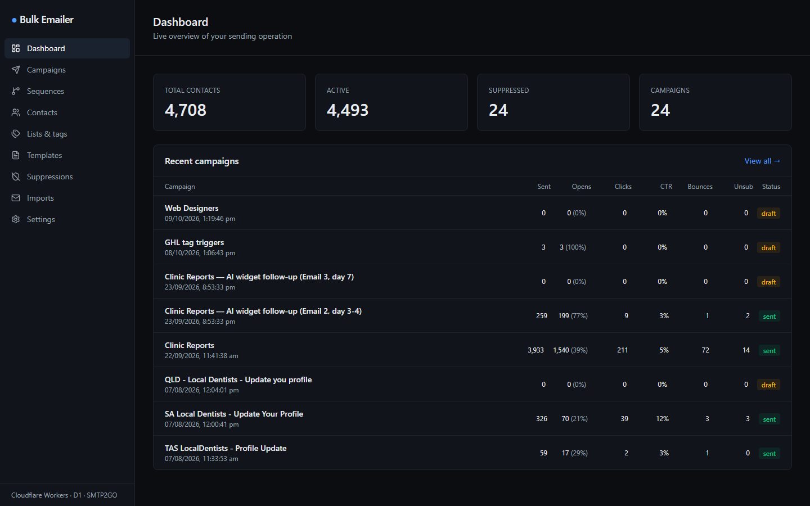

# cloud-sender — Bulk Emailer (Cloudflare Workers + D1 + SMTP2GO)

A self-hosted bulk email tool. React console, Hono API, D1 and Queues inside one
Cloudflare Worker, with SMTP2GO handling delivery. Auth is Cloudflare Access —
there is no app-level login to get wrong.



**Start with [SETUP.md](SETUP.md)**: clone → Cloudflare resources → schema →

Security model and reporting: [SECURITY.md](SECURITY.md).
secrets → local run → deploy → first campaign.

Self-hosted bulk email tool. React SPA + Hono API + D1 + Queues, all in one Worker. Authentication is Cloudflare Access (Zero Trust) — no app-level auth code.

## Stack

- **Cloudflare Worker** (`src/worker/`) — Hono routes + Queue consumer
- **D1** (`migrations/`) — contacts, suppressions, templates, campaigns, sends, webhook_events
- **Queue** `send-queue` — paces sends so each invocation stays under Worker limits
- **SMTP2GO** — actual email delivery via HTTPS JSON API + webhooks
- **React + Vite SPA** (`src/web/`) — served from the Worker's `[assets]` binding

## One-time setup

```bash
npm install

# 1. Create D1 and paste the database_id into wrangler.toml
wrangler d1 create emailer_db

# 2. (Optional) Bind your existing contact D1 for imports
#    The source binding name must be exactly SOURCE_DB unless the Worker code is changed.

# 3. Create queues
wrangler queues create send-queue
wrangler queues create send-dlq

# 4. Run migrations
npm run db:migrate:remote     # for production
# or: npm run db:migrate:local for `wrangler dev`

# 5. Secrets (sensitive — encrypted, never in wrangler.toml)
wrangler secret put SMTP2GO_API_KEY
wrangler secret put WEBHOOK_TOKEN       # any long random string

# DEFAULT_FROM_EMAIL / DEFAULT_FROM_NAME are non-sensitive and live in
# the [vars] block of wrangler.toml — edit them there, not via `secret put`.

# 6. Cloudflare Access
#    Zero Trust → Access → Applications → add a Self-hosted app for your worker host.
#    Add a Bypass policy for path `/api/webhooks/*` so SMTP2GO can POST without auth.
```

## SMTP2GO webhook

In SMTP2GO → Settings → Webhooks, add:

```
https://<your-worker-host>/api/webhooks/smtp2go?token=<WEBHOOK_TOKEN>
```

Subscribe to: `bounce`, `spam`, `unsubscribe`, `delivered`, `opened`, `clicked`.

Bounce / spam / unsubscribe events automatically add the address to `suppressions` and flip the contact status. Delivered / opened / clicked update the matching `sends` row.

## Deploy

GitHub → Cloudflare auto-deploys on push (this workspace's standard flow). Locally:

```bash
npm run build
wrangler deploy
```

## Contact form (public `POST /api/contact`)

A marketing site contact form posts here. Unlike the rest of `/api`, this route is
**public** and sends mail, so it is the one abuse surface a stranger can reach.

What it does:

- validates server-side (required `name`/`email`/`message`, length caps, email shape) → `400 { error: "validation_failed", errors }`
- emails a **fixed recipient** (`CONTACT_TO_EMAIL`, set it to your own inbox). A `to`/`from`/`cc`/`subject` in the body is ignored — this is not an open relay. Reply-To is set to the submitter so a reply goes straight back.
- drops a filled honeypot field (`hp_field`) silently, answering `200 { ok: true }` and sending nothing
- rate-limits per IP (`contact_rate` table, migration `0012`): `CONTACT_RATE_LIMIT` (default 5) submissions per `CONTACT_RATE_WINDOW_SECONDS` (default 600), then `429` with `Retry-After`. The address is only ever stored as a salted SHA-256.
- allows CORS only from the Peak hosts, their Pages previews and `localhost`
- logs one non-identifying line per attempt (message length, whether a phone was given, origin, rate count) — never the name, address, IP or message

### Setup needed before it works live

1. **Cloudflare Access bypass.** The Zero Trust app on this Worker host covers
   the whole hostname (a known trap — it is what silently hid `/api/serve` on the
   adserver). Add a **Bypass** policy for path `/api/contact`, exactly as
   `/api/webhooks/*` already has. Without it the site's POST is 302'd to a login
   page and the form fails.
2. **Secret `IP_SALT`** — any long random string, salts the rate-limit hash:
   `wrangler secret put IP_SALT`.
3. **Migration `0012`** — `npm run db:migrate:remote`.
4. Nothing else: `SMTP2GO_API_KEY` already exists (that is the "reuse" part), and
   `CONTACT_TO_EMAIL` / `CONTACT_RATE_*` are plain vars in `wrangler.toml`.

### Not included

**Turnstile** is deliberately not wired in yet. Adding it would need a Worker
secret (`TURNSTILE_SECRET_KEY`) to verify a token against
`https://challenges.cloudflare.com/turnstile/v0/siteverify`, plus a **site key**
on the frontend — which must not be hardcoded, and which only exists once the
widget is created in the Cloudflare dashboard. The honeypot plus the per-IP rate
limit are the spam control in the meantime; if Turnstile is added later, the
site should render the widget and post its token, and this route should refuse a
missing/invalid token when the secret is set.

## Dev

```bash
npm run dev               # SPA at :8080 (no /api routes — preview only)
npm run worker:dev    # Worker at :8787 with D1 + SMTP2GO (uncomment proxy in vite.config.ts for end-to-end local dev)
```

## Daily batch ("drip") sending

A campaign can carry an optional **sending plan**, so a segment of thousands goes
out at a sane volume instead of in one blast. Per campaign:

- `daily_cap` — most recipients released per day (blank = no cap)
- `send_days` — allowed ISO weekdays, `1,2,3,4,5` = Mon–Fri (blank = any day)
- `send_time` — `HH:MM` local, when that day's batch goes out
- `send_timezone` — IANA zone the window and day boundary are read in
  (blank = the `SEND_TIMEZONE` var, default `Australia/Brisbane`)
- `ramp_start` — allowance on the campaign's **first sending day** (blank = no
  ramp, the cap applies from day one)
- `ramp_days` — how many sending days until the full `daily_cap` is reached
  (`2` = day 1 at `ramp_start`, day 2 onward at the cap)
- `spread_minutes` — minutes to spread each day's batch across (`60` = an hour;
  blank or `0` = the whole day's batch at the window, the old behaviour)

The every-minute cron dispatcher (`dispatchDueCampaigns`) starts the campaign at
the first open window and then releases at most `daily_cap - already released
today` recipients on each allowed day, leaving it `sending` until the audience is
exhausted. **No plan means send all at once**, exactly as before.

There is no "batch released" marker anywhere: the day's allowance is recomputed
from the `sends` table on every tick, against the local day of the campaign's
timezone, so a cron that fires sixty times an hour cannot double-send. Two
consequences worth knowing:

- A paused campaign releases nothing; resume continues from the same day's
  remaining allowance.
- The plan is locked once a campaign is scheduled or running — pause or unschedule
  it first if the volume needs to change.

### Ramp-up

The ramp is the cold-domain start: begin below the cap and step up to it. The
allowance for the k-th **sending** day (k = 1, 2, 3 …) is

```
round(ramp_start + (daily_cap - ramp_start) * (k - 1) / (ramp_days - 1))
   for k <  ramp_days
daily_cap
   for k >= ramp_days
```

so day 1 is exactly `ramp_start` and day `ramp_days` is exactly the cap — e.g.
`ramp_start = 300`, `ramp_days = 2`, `daily_cap = 500` reads *"Day 1: 300, day 2
onward: 500"* in the editor.

Which sending day the campaign is on is **derived from the `sends` table** — the
distinct local days that actually have sends — never from a stored counter, so
the per-minute cron can re-enter a tick, a run can be reaped, and a pause/resume
still lands on the right step. Days that send nothing (a skipped weekend, a
paused day) do not consume a step, so the ramp is a count of *sending* days, not
of calendar days.

The ramp is a shape for the cap, so it needs a cap to grow into: `ramp_start` at
or above `daily_cap`, `ramp_days = 1`, or either field on its own is **not** a
ramp and the plan behaves as the flat cap does. The editor says so plainly rather
than leaving you to guess, and the projected finish is computed from the ramp
("about 8 sending days, finishing around 6 Oct"), not estimated from the cap.

### Spread

`spread_minutes` meters each day's batch instead of letting the whole day's
allowance leave at once, which is the shape that reads as bulk mail at 500/day.
The release is a leaky bucket measured against the clock, never against the tick
count:

```
due(now)  = elapsed minutes since the window opened x (day allowance / spread)
release   = min(day allowance, due(now)) - already released today
```

so a missed tick (a reaped harness, a slow run) releases only the slices elapsed
time has earned — never a backlog of whole batches — and the day still totals its
allowance by the end of the spread, which is why the projected finish moves by
minutes under a spread rather than growing an extra day. The first slice is due
with the window opening, so the batch starts at `send_time` and never before it.

With `spread_minutes` blank or `0` the whole day's batch is released at the
window, exactly as before. The editor shows the spread in words — "up to 500 a
day, spread across the hour (~9 a minute)" — and reads as *up to* that rate when
a ramp is in play, because the rate follows the day's allowance (day 1 of a
300→500 ramp is ~5 a minute, not ~9).

## Throughput tuning

Queue consumer config in `wrangler.toml`:

- `max_batch_size` — emails sent per consumer invocation (default 25)
- `max_concurrency` — parallel consumers (default 4)
- → effective rate ≈ batch_size × concurrency / batch_timeout seconds

Start low; ratchet up as SMTP2GO rate limit allows.

## Architecture

```
Cloudflare Access ─▶ Worker
                      ├── /api/* (Hono)              D1 ◀──┐
                      ├── /api/webhooks/* (no Access)      │
                      ├── static SPA (Assets)               │
                      └── queue() consumer ─▶ SMTP2GO ──────┘
                            ▲
        producer enqueues ──┘  (on POST /api/campaigns/:id/send)
```

The design decisions and their gotchas are documented inline in `src/worker/`.
